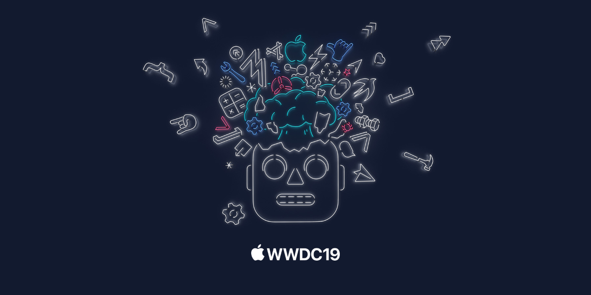

# WWDC 2019 - Scholarship

List of student submissions for the WWDC 2019 - Scholarship. The list is in alphabetical order.

Check out the [YouTube Playlist](https://www.youtube.com/playlist?list=PLRg_ppvslSwr6rucF7IDsiW8nNE2zzJ76) to watch the projects.

### How to add your submission?
1. **[Click here to open the form](https://github.com/wwdc/2019/issues/new?template=submit.yml)** and fill it in.
2. Send it. A bot checks your entry within a minute and tells you if anything needs fixing. You can edit the form after sending.
3. When it is approved your entry appears on this list.

#### How to update or remove your submission?
Use the **[update form](https://github.com/wwdc/2019/issues/new?template=update.yml)**. Only the person who sent the entry can change it.

### Submissions

| Participant | Links  | Status            |
|:--|:--|:--|
| [Aaron Cheung](https://twitter.com/Aaron_Cheung430) | [GitHub](https://github.com/AaronCheung430/WWDC2019) · [Video](https://youtu.be/0y0bctNM1yY) ARKit, SceneKit, AVFoundation, Foundation |  |
| [Abram Situmorang](https://situmorang.me) | [GitHub](https://github.com/abrampers/WWDC19-Submission) MetalKit |  |
| [Adam Giesinger](https://twitter.com/adamgiesinger) | [GitHub](https://github.com/adamgiesinger/wwdc-2019-scholarship) CoreML, Vision, UIKit |  |
| [Adrian Kashivskyy](https://twitter.com/akashivskyy) | [GitHub](https://github.com/akashivskyy/wwdc-sight) AVFoundation, CoreImage, CoreLocation, Metal |  |
| [Adrian Labbé](https://twitter.com/develobile) | [GitHub](https://github.com/ColdGrub1384/WWDC19) · [Video](https://www.instagram.com/tv/BvaK4DOBrOA) UIKit, Drag &amp; Drop |  |
| [Alan Victor](https://github.com/AlanVic) | [GitHub](https://github.com/AlanVic/WWDC2019_WearingMinimalism) · [Video](https://youtu.be/bTQnOBnU1jk) SpriteKit, AVFoundation, UIKit |  |
| [Alcides Junior](https://twitter.com/alcidesjuniorbr) | [GitHub](https://github.com/alcidesjunior/ihitthings) · [Video](https://www.youtube.com/watch?v=UtP5xFr3GlY) SpriteKit |  |
| [Alessandro Alberti](https://www.facebook.com/alessandro.alberti.1614) | [Video](https://youtu.be/xwGMqdJtqyQ) SpriteKit, GameplayKit, ARKit, SceneKit |  |
| [Alessandro Minopoli](https://www.linkedin.com/in/alessandro-minopoli/) | [Video](https://www.youtube.com/watch?v=EAq9ehyH_LY) PlaygroundBook, SpriteKit, CoreML, Vision |  |
| [Alex Danilenko](https://twitter.com/Alexsey333) | [GitHub](https://github.com/Alexsey333/wwdc19) · [Video](https://youtu.be/_MEUeRppeWc) SceneKit |  |
| [Alexander Zank](https://twitter.com/alexlikeplus) | [GitHub](https://github.com/AlexLike/WWDC19Playground) · [Video](https://youtu.be/3lVUhAldC9Q) UIKit Dynamics, AVFoundation, ARKit, SceneKit |  |
| [Alexandru Barbulescu](https://www.linkedin.com/in/barbulescualex/) | [GitHub](https://github.com/barbulescualex/BeatMatch) · [Video](https://youtu.be/7e6X7DzddIQ) AVFoundation, Accelerate, Metal |  |
| [Aline Borges](https://www.linkedin.com/in/alinekborges/) | [GitHub](https://github.com/alinekborges/DancingFractals) · [Video](https://www.youtube.com/watch?v=xSpO6TSHe4g&t=64s) Fractals, NSOperation, UIKit |  |
| [Allyson Aberg](https://www.linkedin.com/in/allysonaberg/) | [GitHub](https://github.com/allysonaberg/WWDC2019) AVFoundation, SpriteKit |  |
| [Alysson Façanha](https://github.com/allymf) | [GitHub](https://github.com/allymf/Generative-Art-Playground) SpriteKit, UIKit |  |
| [Amanda Li](https://github.com/amandaLi7) | [GitHub](https://github.com/amandaLi7/objects_in_diff_lang) ARKit, CoreML, SpriteKit, UIKit |  |
| [Anav Mehta](https://3dwaffles.blogspot.com) | [GitHub](https://github.com/anavmehta/3dminesweeper) · [Video](https://www.youtube.com/watch?v=5fTMDxVzlhc) AVFoundation, SceneKit, AVKit |  |
| Andika Leonardo | [GitHub](https://github.com/andikaleonardo/WWDC-2019-Scholarship-Submissions) QuartzCore, UISceneKit, UIStackView, CGFloat/CGRect |  |
| [Andrew Sawyer](http://andrewjsawyer.com/) | [GitHub](https://github.com/aswyer/Emotist) SceneKit |  |
| [Andy Jiehan Aldicho](https://twitter.com/scitsiugnil) | [GitHub](https://github.com/jiehanAldicho/WWDC2019) · [Video](https://youtu.be/PB19nN_fwYo) SpriteKit, GameplayKit, AppKit |  |
| [Andy Luo](https://github.com/AndyLuoJJ) | [GitHub](https://github.com/AndyLuoJJ/WWDC-2019-Scholarship.git) UIKit, Foundation, CoreGraphics |  |
| [Anthony Li](https://anli.dev) | [GitHub](https://github.com/anli5005/bubble-tea-playground) SceneKit, SpriteKit, CoreGraphics |  |
| [Archer Gardiner-Sheridan](https://twitter.com/Archergs14) | [GitHub](https://github.com/archergs/WWDC2019Submission) SpriteKit, AppKit |  |
| [Arnaud Nommay](https://www.linkedin.com/in/arnaud-nommay/) | [GitHub](https://github.com/Armay2/WWC19-Scholarship-Submission) · [Video](https://www.youtube.com/watch?v=3S-ImTCCmEI) SpriteKit, Foundation |  |
| [Arved Viehweger](https://twitter.com/arvedviehweger) | [GitHub](https://github.com/arvedviehweger/WWDC2019) · [Video](https://www.youtube.com/watch?v=U0UI_ozRLRQ) UIKit, Foundation, AVFoundation |  |
| [Aurther Nadeem](https://www.instagram.com/aurther_nadeem/?hl=en) | [GitHub](https://github.com/Aurther-Nadeem/WWDC-2019) ARKit, CoreAnimation, AVFoundation, UIKit |  |
| [Avery Vine](https://averyvine.com) | [GitHub](https://github.com/AveryVine/Twister) UIKit, SpriteKit, AVFoundation |  |
| [Ayoob Nazeem](https://github.com/Ayoob7/) | [GitHub](https://github.com/Ayoob7/hashing-functions-swift-playgrounds) · [Video](https://www.youtube.com/watch?v=qtJhLRvTBi8&feature=youtu.be) SpriteKit, UIKit, Foundation |  |
| [Bartłomiej Pluta](https://github.com/bpluta) | [GitHub](https://github.com/bpluta/Faze) UIKit, Vision, SceneKit |  |
| Bastian Kusserow | [GitHub](https://github.com/BastianKusserow/WWDC2019Submission) · [Video](https://www.youtube.com/watch?v=UM5LJQ2sxaA) UIKit, SpriteKit, Vision, CoreML |  |
| [Batuhan Saka](https://twitter.com/strawb3rryx7) | [Video](https://youtu.be/L4PDdMHfuFQ) UIKit, CoreML, Vision, AVFoundation |  |
| [Benjamin Hutter](https://twitter.com/BenjaminHutter1) | [GitHub](https://github.com/benjaminhtr/WWDC19-Scholarship-Submission) UIKit, CoreML, Vision, AVFoundation |  |
| Bjorn Sahlin | [GitHub](https://github.com/bjsahlin/wwdc2019Playground) UIKit, AVFoundation |  |
| [Bruno Pastre](https://pastre.github.io) | [GitHub](https://github.com/pastre/wwdc-2019-playground) UIKit, ARKit, AVFoundation |  |
| [Carol Chen](https://carolchen.me) | [GitHub](https://github.com/kipply/sorting_algorithm_visualization_and_aurlization_in_a_swift_playground) · [Video](https://www.youtube.com/watch?v=-fTBJMBzVng) |  |
| [Carolina Niglio](https://carolinaniglio.webflow.io) | [GitHub](https://github.com/carolinaniglio/ColorTheoryPlaygroundBook-WWDC2019) · [Video](https://www.youtube.com/watch?v=Uh4emP0uHU8&feature=youtu.be) SpriteKit |  |
| [Cecily Kerns](https://twitter.com/Cecily_Kerns) | [GitHub](https://github.com/CecilyKerns/WWDC/) · [Video](https://youtu.be/lls2CAP4ugw) SpriteKit, UIKit, PlaygroundBooks, Accessibility |  |
| [Celal Dogan Kaya](https://twitter.com/celaldogankaya) | [Video](https://youtu.be/PfozBCsdNhI) CoreML, Vision, ARKit, CreateML |  |
| [Charles Truluck](https://www.twitter.com/charlestruluck_) | [GitHub](https://github.com/charlestruluck/WWDC19) CommonCrypto, UIKit, SceneKit |  |
| [Chase Clark](https://www.instagram.com/chaseclark_dev) | [GitHub](https://github.com/ChaseClark-Dev/Draw-ML) CoreML, UIKit, CreateML, CoreQuartz |  |
| [Chris Leonard](https://www.twitter.com/chrisleonard23) | [GitHub](https://github.com/crleonard) UIKit, SpriteKit |  |
| [Cibele Paulino](https://github.com/CibelePaulinoAndrade) | [GitHub](https://github.com/CibelePaulinoAndrade/WWDC2019_PlaygroundBook_CibelePaulino) · [Video](https://www.youtube.com/watch?v=pdgAx1aGPmA) SceneKit, ARKit, AVFoundation, UIKit |  |
| Claudio Cavalli | [GitHub](https://github.com/claudioitalian12/Fireworks-WWDC19) · [Video](https://www.youtube.com/watch?v=wwnPXkzdjys&feature=youtu.be) ARKit, AVFoundation, PlaygroundBook |  |
| [Cristian Garske](https://garsrepublic.com) | [GitHub](https://github.com/CristianGarske/WWDC19Submission) · [Video](https://youtu.be/pvmH_zNNX0k) UIKit, SpriteKit, AVFoundation |  |
| [Daniel Dorazio](https://www.instagram.com/danny.dorazio/) | [GitHub](https://github.com/dandorazz/wwdc19) UIKit, SpriteKit |  |
| [Daniel Gruber](https://igruber.me) | [Source](https://repo.goma-cms.org/users/daniel.gruber/repos/wwdc-2019/browse) UIKit, PlaygroundBooks, CoreGraphics |  |
| [Daniel Riege](https://www.instagram.com/danielriege/) | [GitHub](https://github.com/danielriege/WWDC19-Application) UIKit, CommonCrypto |  |
| [Daniel Sykes-Turner](https://daniel.st) | [GitHub](https://github.com/dsykesturner/WWDC-2019-Submission) · [Video](https://www.youtube.com/watch?v=26A1J4NKKvw) SpriteKit, AVFoundation, CoreMotion |  |
| [Daniel Wang](https://danielwang.dev) | PlaygroundBooks, SceneKit, AVFoundation |  |
| [Darshil Patel](https://darshilpatel.com) | [Video](https://www.youtube.com/watch?v=GUPvFbPov20) SpriteKit, ARKit, AVFoundation |  |
| [Davide Tarantino](https://www.linkedin.com/in/davide-tarantino-b6a08a17a/) | [GitHub](https://github.com/davix93/TheTuringMachine-WWDC19) · [Video](https://youtu.be/NY6P2ktaJx4) PlaygroundBook, SpriteKit, UIKit |  |
| [Dennis Vermeulen](https://github.com/Dennissimeau) | [GitHub](https://github.com/Dennissimeau/melanomafinder) · [Video](https://www.youtube.com/watch?v=QU2mxqv1syE&t) CoreML, CreateML, Vision, UIKit |  |
| Denny Caruso | [GitHub](https://github.com/dennewbie/PizzaCode-Cook) · [Video](https://youtu.be/aVSkcdBZG14) UIKit, AVFoundation |  |
| [Dhrumil Dhanesha](http://www.dhrumildhanesha.com/) | [GitHub](https://github.com/DhrumilDhanesha/wwdc19) · [Video](https://www.youtube.com/channel/UCXQJa9anuEkVlS2wpXbfM4Q?view_as=subscriber) PlaygroundSupport, SpriteKit, Foundation, GameKit |  |
| [Dowland Aiello](https://github.com/dowlandaiello) | [GitHub](https://github.com/polaris-project/swift-polaris) · [Video](https://youtu.be/6CUK_pxzQ-4) Foundation, UIKit |  |
| [Eduarda Mello](https://www.linkedin.com/in/dudamello/) | [GitHub](https://github.com/dudamello/blast-playground) · [Video](https://youtu.be/o7If2qRqcfY) UIKit, ARKit, AVFoundation |  |
| [Elias Paulino](https://github.com/EliasPaulinoAndrade) | [GitHub](https://github.com/EliasPaulinoAndrade/Play-Island) · [Video](https://www.youtube.com/watch?v=3LVg8Bo1DCg&t=34s) SceneKit, SpriteKit, AVFoundation, UIKit |  |
| [Erik Martin](https://twitter.com/erikmartin29) | [GitHub](https://github.com/erikmartin29/INKBLOB) · [Video](https://www.youtube.com/watch?v=bDyoOJ2X3EU) SpriteKit, OpenGL, Foundation |  |
| [Ethan Humphrey](https://twitter.com/EthanInnovator) | [GitHub](https://github.com/EthanTheInnovator/LearningMachineLearning) Playground Book, CoreML, Vision, UIAccessibility |  |
| [Fan Bai](https://github.com/fullalien) | [GitHub](https://github.com/fullalien/WWDC19_Patternful) UIKit, CoreGraphics |  |
| [Fikret Şengül](https://www.fikretsengul.me) | [GitHub](https://github.com/fikretsengul) SpriteKit |  |
| [Frost Lee](https://frost-lee.github.io) | [GitHub](https://github.com/Frost-Lee/Now-You-Hear-Me) AVFoundation |  |
| [Gabriel D'Luca](https://www.linkedin.com/in/gabriel-d-luca-340001126/) | [GitHub](https://github.com/gabrieldluca/mosaic) · [Video](https://www.youtube.com/watch?v=8aJH1pYvUDE) UIKit, SceneKit, AVFoundation, CoreAnimation |  |
| [Gautham Elango](https://gggcubed.com/) | [GitHub](https://github.com/gg2001/WhatsApple) AVFoundation, Vision, CoreML, Image I/O |  |
| [Gennaro Frate](https://twitter.com/GennaroFra) | [GitHub](https://github.com/TheGen30) ARKit, SceneKit, SpriteKit |  |
| [George Bougakov](https://bygeorgenet.me) | [Video](https://youtu.be/beSs2rfBJA4) SpriteKit |  |
| [Gianpiero Spinelli](https://twitter.com/gianpispi) | UIKit, Foundation |  |
| [Giovanni Bruno](https://www.instagram.com/gg.bru/) | [GitHub](https://github.com/GiovanniLuigi/ToRecycle_WWDC2019) · [Video](https://www.youtube.com/watch?v=GVS3H0rR7Rk) SpriteKit, GameplayKit |  |
| [Grant Emerson](http://www.821apps.com/) | [GitHub](https://github.com/GrantJEmerson/WWDC19) UIKit, SceneKit, AVFoundation, ARKit |  |
| [Grayson Martin](https://graysonmartin.net) | [GitHub](https://github.com/gm3197/wwdc19) SpriteKit, PlaygroundSupport |  |
| [Guilherme Bayma](https://twitter.com/guibayma) | [GitHub](https://github.com/GuiBayma/DiscoveringML) AVFoundation, CoreML, PlaygroundBook, UIKit |  |
| [Guillermo Cique](https://twitter.com/guiyec) | [GitHub](https://github.com/GuiyeC/WWDC-2019) · [Video](https://www.youtube.com/watch?v=LkUXrp9zjJY) Neural Networks, UIKit, CoreAnimation, Playground Books |  |
| [Gustavo Leite](https://www.linkedin.com/in/gustavo-garcia-leite-1228b9175/) | [GitHub](https://github.com/GUUSTA/WWDC19-Dyslexsee) · [Video](https://www.youtube.com/watch?v=5i2IcbbnkOs) UIKit, Playground Books |  |
| [Haotian Zheng](http://fincher.im/) | [GitHub](https://github.com/JustinFincher/WWDC19Playground) · [Video](https://www.youtube.com/watch?v=otw49ioAm2U) UIKit Dynamics, SpriteKit, AVFoundation |  |
| [Harshdeep Kahlon](http://harshdeepkahlon.com/) | [GitHub](https://github.com/HarshdeepKahlon/WWDC19) UIKit, CoreImage, Foundation |  |
| [Hengyu Liu](https://liuhengyu.com/) | ARKit |  |
| [Hengyu Zhou](https://github.com/hengyu) | [Video](https://www.youtube.com/watch?v=rWrB6CPTlwA&t=78s) ARKit, CoreML, SceneKit, Vision |  |
| [Henrik Storch](https://www.thisIsTheFoxe.me) | [GitHub](https://github.com/thisIsTheFoxe/WWDC19) · [Video](https://youtu.be/hhxlzOD5ACE) PlaygroundSupport, UIKit, AVFoundation |  |
| [Hristo Staykov](https://hristost.github.io/) | [GitHub](https://github.com/hristost/tic-tac-toe-playground) PlaygroundSupport, UIKit |  |
| [Hubert Tatra](https://www.linkedin.com/in/hubert-tatra/) | [GitHub](https://github.com/hubertme/IndonesiaHeritage-WWDC) · [Video](https://www.youtube.com/watch?v=TU1rTgtRy-E) UIKit, AVFoundation |  |
| [Hugo Lispector](https://www.linkedin.com/in/hugo-lispector/) | [GitHub](https://github.com/HugoLis/WWDC19-Scholarship) · [Video](https://youtu.be/7bpkOrwAIeU) SpriteKit |  |
| [Iqra Urooj](https://twitter.com) | [Video](https://youtu.be/1mGtZw9Ar1k) SpriteKit, AVFoundation |  |
| [Isaac Rodriguez](https://koide.top/) | [Video](https://www.youtube.com/watch?v=S8P0UGW_RBw) UIKit, AVFoundation |  |
| [Jacky Yu](https://twitter.com/HachimanCaptain) | [GitHub](https://github.com/CaptainYukinoshitaHachiman/Cryptography-and-Privacy) · [Video](https://youtu.be/nsK-6ZIX3pQ) UIKit, Security, CommonCrypto |  |
| [Jacob Tilly](https://www.twitter.com/jacobtilly00/) | UIKit |  |
| [Jaesung Lee](https://github.com/jaesung-wwdc) | UIKit, AVFoundation, SceneKit, ARKit |  |
| [Jahanzeb Jabbar](https://twitter.com/Jahanzeb_me4u) | [GitHub](https://github.com/jahanzeb-j/CodeWorld) · [Video](https://youtu.be/9WfrwX6ebVI) SpriteKit, GameplayKit, CoreMotion, AVFoundation |  |
| [Jaime Blasco](https://github.com/jamesblasco) | [GitHub](https://github.com/jamesblasco/morse_coding_swift_playground) UIKit, AVFoundation |  |
| jamfly | [GitHub](https://github.com/jamfly/WWDC-2019) CoreML, NaturalLanguage, ImageIO, Vision |  |
| [Jari Koopman](https://twitter.com/LotUDev) | [GitHub](https://github.com/MrLotU/WWDC19) CoreMotion, SpriteKit |  |
| [Jiaqi Liu](https://twitter.com/tuzi_moe) | SpriteKit, ARKit, UIKit, CoreML |  |
| [Jiaxing Yu](https://twitter.com/Albertyujx) | [GitHub](https://github.com/YujxZJCN/WWDC19-SaveMe) ARKit, SceneKit, AVFoundation, CAEmitterLayer |  |
| [Jobe Dylbas](https://github.com/jobedylbas/) | [GitHub](https://github.com/jobedylbas/librasplayground) UIKit, Foundation |  |
| [John Ciocca](https://www.twitter.com/JohnCiocca) | UIKit, SpriteKit, CoreML, AVFoundation |  |
| [John Palevich](https://www.instagram.com/johnpalevich/) | [GitHub](https://github.com/JohnPalevich/wwdc2019submission) ARKit, SceneKit, UIKit, Wings3D |  |
| [Jordan Osterberg](https://twitter.com/OsterbergJordan) | [GitHub](https://github.com/JordanOsterberg/wwdc/) · [Video](https://www.youtube.com/watch?v=G4_Do_m50NQ) SpriteKit, UIKit, PlaygroundBooks, Accessibility |  |
| [Julian Schiavo](https://twitter.com/justjs_dev) | [GitHub](https://github.com/justJS/wwdc/tree/master/2019) · [Video](https://www.youtube.com/watch?v=dIYKp80OxE8) AVFoundation, CoreImage, UIKit |  |
| [Junaid Abdurahman](https://twitter.com/junaidxabd) | [Video](https://youtu.be/Cc5GZSAJ_hQ) SceneKit, UIKit, CoreMotion, AVFoundation |  |
| Kamil Strzelecki | [GitHub](https://github.com/NSFatalError/Assistant) · [Video](https://youtu.be/D22HrNFokFw) AppKit, CoreAnimation, CoreML, NaturalLanguage |  |
| [Kanishka](https://www.instagram.com/ralasi_code) | [Video](https://www.youtube.com/watch?v=54wndSzKW_E&t=38s) UIKit, AVFoundation |  |
| [Kenan Atmaca](https://twitter.com/uikenan) | [GitHub](https://github.com/KenanAtmaca/WWDC19) SpriteKit, UIKit |  |
| [Kevin Schaefer](https://www.schaefkn.com) | [GitHub](https://github.com/schaefkn/WWDC19) ARKit, SceneKit, SpriteKit, AVFoundation |  |
| [Kristof Kocsis](https://kristofk.com) | [GitHub](https://github.com/kristofk/WWDC19-Submission-Public) · [Video](https://youtu.be/95BlKKj23no) UIKit, CoreGraphics, PlaygroundBooks |  |
| [Kyoya Yamaguchi](https://twitter.com/kyoya1123) | [GitHub](https://github.com/kyoya1123/Breakout3D) · [Video](https://youtu.be/u520SAMfV6s) UIKit, ARKit, SceneKit, AVFoundation |  |
| [Lachlan Bell](https://lachy.io) | [GitHub](https://github.com/lachlanbell/WWDC19) · [Video](https://youtu.be/p_SrgzPHf_Y) ARKit, Model I/O, SceneKit, UIKit |  |
| [Lalo Martínez](https://github.com/lalomts) | [GitHub](https://github.com/lalomts/Flip) · [Video](https://youtu.be/nh9yuhgATsM) SpriteKit, TouchBar |  |
| [Lennart Kerkvliet](https://www.instagram.com/lennartkerkvliet/) | [Video](https://www.youtube.com/watch?v=HsaaxNWrP5Y) ARKit, SpriteKit, UIKit (Drag and Drop), CoreMotion +1 |  |
| [Liam Rosenfeld](https://liamrosenfeld.com) | [GitHub](https://github.com/liamrosenfeld/FourierArtist) SpriteKit, AppKit, Foundation |  |
| [Linh Bouniol](https://twitter.com/linhbouniol) | [Video](https://www.youtube.com/watch?v=XywaVKxTnys) CoreML, CreateML, Vision, AVFoundation |  |
| [Liuliet Lee](https://github.com/LiulietLee) | [GitHub](https://github.com/LiulietLee/mikutap) UIKit, MetalKit, MediaPlayer, AVFoundation |  |
| [Lucas Pelinzon](https://pelinzon.dev) | [GitHub](https://github.com/pelinzon/ExploringNaturalLanguage) · [Video](https://www.youtube.com/watch?v=UUNbzfvyk-4) CoreML, NaturalLanguage, PlaygroundBook, UIKit |  |
| Luiz Processo | [GitHub](https://github.com/luizprocesso/wwdc2019) SpriteKit, AVFoundation, PlaygroundBook |  |
| [Maanas Manoj](http://maanas.me) | [GitHub](https://github.com/themaanas/WWDC2019) · [Video](https://www.youtube.com/watch?v=5ge6ph0qU5M) UIKit |  |
| Mansi Gandhi | [GitHub](https://github.com/mansimg/-WWDC-2019-Scholarship-Submission-Green-Sort) · [Video](https://youtu.be/kx9YG04_0JQ) SpriteKit, UIKit |  |
| Marco Tammaro | [GitHub](https://github.com/marcotammaro/WWDC19.git) · [Video](https://youtu.be/ELh54nK4Deg) UIKit, SpriteKit, AVFoundation |  |
| [Mark Bruckert](https://twitter.com/Mark_Bruckert) | [GitHub](https://github.com/mbruckert/WWDC-2019-Apple-TV) · [Video](https://youtu.be/mr5sKyyi4Pc) UIKit, AVKit |  |
| [Marko Crnkovic](https://www.mbobpro.com) | [GitHub](https://www.github.com/chih98/wwdc2019) · [Video](https://www.youtube.com/watch?v=24s-EoxZg0E) SpriteKit, AVFoundation |  |
| [Matej Plavevski](https://github.com/matejmecka) | [GitHub](https://github.com/MatejMecka/mr.Recyclo-Trashowski/) UIKit, CoreML, AVFoundation, WebKit |  |
| [Matthew Kim](https://www.youtube.com/channel/UCi6VkPnL8sh_9wvu7ndDZig) | [GitHub](https://github.com/mjaydenkim/wwdcsubmission19) · [Video](https://www.youtube.com/watch?v=G4AFukITt_k&t=1s) UIKit, AVFoundation |  |
| [Maulana Rizal Hilman](https://www.khilman.com) | [GitHub](https://github.com/drawrs/WWDC19-Submission-SandCastle-Game) · [Video](https://youtu.be/SVYPdaOCv_4) UIKit, AVFoundation, GestureRecognizer |  |
| Max Härtwig | [GitHub](https://github.com/Vyax/WWDC-2019-Saving-our-Planet) SceneKit, PlaygroundBooks |  |
| [Mehul Mohan](https://twitter.com/mehulmpt) | [GitHub](https://github.com/mehulmpt/wwdc-2019) · [Video](https://www.youtube.com/watch?v=owGuqiHHJI8&feature=youtu.be) SceneKit, ARKit, UIKit, AVFoundation |  |
| [Michael Barney](https://www.instagram.com/michaelbarneyjr) | [GitHub](https://github.com/MichaelBarney/SwiftRoll) · [Video](https://youtu.be/OW2NTA4YytE) SpriteKit |  |
| [Michael Bernard](https://www.linkedin.com/in/michaelbnd/) | [GitHub](https://github.com/michaelbnd/wwdc-SpaceEnergy) · [Video](https://www.youtube.com/watch?v=sIAE1Bo9Bgc) SpriteKit, Foundation |  |
| [Michael Dugan](https://www.linkedin.com/in/michael-dugan-733764177/) | AVFoundation, UIKit |  |
| [Michal Cichecki](https://www.linkedin.com/in/mcichecki/) | [GitHub](https://github.com/mcichecki/complex-grapher) SpriteKit, UIKit, AVFoundation |  |
| [Mingyuan Hu](https://github.com/miamiaH) | [Video](https://www.youtube.com/watch?v=7PZi3lce_Pw) ARKit, SceneKit, SpriteKit, Vision |  |
| [Minhyuk Kim](https://www.linkedin.com/in/mininnykim) | [GitHub](https://github.com/mininny) · [Video](https://youtu.be/HpQwxVZfzTA) ARKit, SpriteKit, AVFoundation, UIKit |  |
| [Mohamed Salah](https://mohasalah.com) | [GitHub](https://github.com/mohasalahh/WWDC19-Scholarship-Submission) · [Video](https://www.youtube.com/watch?v=bH9FwLSS1LA) CoreML, CreateML, CoreGraphics, UIKit |  |
| [Muhammad Dary Azhari](https://stackoverflow.com/users/5834822/dary) | [Video](https://www.youtube.com/watch?v=8B2iL92U58Q) UIKit, AVFoundation |  |
| [Naman Bishnoi](https://lucidex.co) | [GitHub](https://github.com/diabloxenon/Race-Against-Time) ARKit, SceneKit, AVFoundation, CoreMotion +1 |  |
| [Nathan Sesti](https://github.com/sestinj) | [GitHub](https://github.com/sestinj/WWDC19-Submission) · [Video](https://www.youtube.com/watch?v=SMdJv-LSdec) SpriteKit, AppKit |  |
| [Nicholas Grana](https://twitter.com/nicholasgranaa) | [GitHub](https://github.com/Nicholas714/WWDC-2019) · [Video](https://youtu.be/yf3cmby82N4) ARKit, SceneKit, SpriteKit, UIKit |  |
| [Nicholas R. Putra](https://www.linkedin.com/in/nicholas-rp/) | UIKit, SpriteKit, AVFoundation |  |
| [Niklas Buelow](https://twitter.com/niklasbuelow) | [GitHub](https://github.com/insightmind/WWDC19Scholarship) SpriteKit, AVFoundation, UIKit, CoreGraphics |  |
| [Niklas Korzeniewski](https://www.twitter.com/derNiklaas) | [GitHub](https://github.com/derNiklaas/Fruit-Smasher) SpriteKit |  |
| [Oksana Bolibok](https://www.linkedin.com/in/oksana-bolibok-1ba8a9165/) | [GitHub](https://github.com/Rok-sana/WWDC19-LogicBoard) · [Video](https://youtu.be/vs4REdz2i_w) ARKit, SpriteKit, Foundation, UIKit |  |
| [Omer Gulen](https://twitter.com/omergulenn) | [GitHub](https://github.com/omergulen/wwdc19) UIKit, CoreAnimation |  |
| [omrobbie](https://omrobbie.com) | [GitHub](https://github.com/omrobbie/WWDC19) · [Video](https://youtu.be/zgoVTi7xyJU) UIKit, AVFoundation |  |
| [Oscar Fridh](https://www.facebook.com/oscar.fridh) | [GitHub](https://github.com/OscarFridh/ConcentrationWWDC19) · [Video](https://www.youtube.com/watch?v=IIzL6KAL5zM) UIKit, AVFoundation |  |
| [Oscar Gorog](https://oscargorog.com) | [GitHub](https://github.com/OkiRules/WWDC19-Submission) SpriteKit, AVFoundation, JSON Parsing |  |
| Ozan Mirza | [GitHub](https://github.com/ozanmirza1/WWDC-2019-Neural-Networks) · [Video](https://youtu.be/1gk3QSbFVpU) CoreML, Vision, UIKit, QuartzCore |  |
| [Patcharapon Joksamut](https://twitter.com/Frost_Noxia) | [GitHub](https://github.com/patcharapon-j/AlgoMaze) · [Video](https://www.youtube.com/watch?v=m-xPh7gDT9o) UIKit |  |
| [Peijun Weng](https://github.com/windstormeye) | [GitHub](https://github.com/windstormeye/WWDC19_brocadeOfLiNationality) UIKit |  |
| [Penélope Araújo](https://www.linkedin.com/in/penelopearaujo/) | [GitHub](https://github.com/penelopearaujo/TangramChallenge) SpriteKit |  |
| [Pierpaolo Sepe](https://www.linkedin.com/in/pierpaolosepe/) | [Video](https://youtu.be/HI5lGdYwcFA) ARKit, AVFoundation, CoreML, PlaygroundBook |  |
| [Piotr Jeremicz](https://www.linkedin.com/in/piotrekjeremicz/) QuantumC Simulator | [GitHub](https://github.com/piotrekjeremicz/wwdc-2019) · [Video](https://www.youtube.com/watch?v=V48LRbOqf3k) SceneKit, UIKit, PlaygroundBook |  |
| [Pon Mahil Arasu](https://www.instagram.com/ponmahilarasu/) | [GitHub](https://github.com/MahilArasu/WWDC-19-submission) · [Video](https://youtu.be/PP5C1-w_wVI) UIKit |  |
| [Pranav Karthik](https://twitter.com/PranavKarthik15) | [GitHub](https://github.com/ZORLAXX/WWDC19Submission) · [Video](https://youtu.be/dvN3aRJJju0) ARKit, UIKit, SceneKit, AVFoundation |  |
| [Qingyang Hu](https://twitter.com/hqy_2000) | [GitHub](https://github.com/hqy2000/Railway) SpriteKit, PlaygroundBooks |  |
| [Rafael Ferreira](https://github.com/Rafaelfferreira) | [GitHub](https://github.com/Rafaelfferreira/PlaygroundOfLife/tree/master) UIKit |  |
| [Raffaele Ascione](https://raffaeleascioneofficial.wordpress.com/) | [GitHub](https://github.com/raffesc/The-Mikado-game) · [Video](https://www.youtube.com/watch?v=Mz86J83I-Lo) SceneKit, ARKit, UIKit |  |
| [Raghav Vashisht](https://twitter.com/dramikei) | [GitHub](https://github.com/dramikei/wwdc19-submission) CoreGraphics, UIKit, AVFoundation, UIImpackFeedbackGenerator |  |
| [Renan Magagnin](https://www.linkedin.com/in/renanmagagnin/) | [GitHub](https://github.com/RenanMagagnin/mindblower-wwdc19) · [Video](https://www.youtube.com/watch?v=xH9cn7BtG8k) SpriteKit, AVFoundation |  |
| [Renata Faria](https://www.linkedin.com/in/renatafg-240996) | [GitHub](https://github.com/xReee/wwdc2019) · [Video](https://youtu.be/xcTyaG1eo98) ARKit, UIGestures, AVFoundation, SceneKit |  |
| [Rick Wierenga](https://twitter.com/rickwierenga) | [GitHub](https://github.com/rickwierenga/WWDC19Playground) · [Video](https://www.youtube.com/watch?v=GEUrMbx_uac) CreateML, CoreML, Vision, AVFoundation |  |
| [Riley Walz](https://twitter.com/rtwlz) | [Video](https://www.youtube.com/watch?v=INF2xPXhTbY) SpriteKit, GameplayKit, NaturalLanguage |  |
| [Rodrigo Farias](https://github.com/rodrigowoulddo) | [GitHub](https://github.com/rodrigowoulddo/WWDC-2019-The-Bacteria-Adventure) · [Video](https://www.youtube.com/watch?v=Hurv-P0hw_I) SpriteKit, AVFoundation |  |
| [Roland Horváth](https://twitter.com/hroland_) | [Video](https://www.youtube.com/watch?v=M-qtaV6lY_g) CoreML, Vision, ARKit, AVFoundation |  |
| [Sahith Thummalapally](https://sahithr03.github.io) | [GitHub](https://github.com/sahithr03) · [Video](https://youtu.be/h0jERgTNPdU) AVKit, UIKit, Vision, CoreML |  |
| [Sai Kambampati](https://twitter.com/Sai_K1065) | [Video](https://www.youtube.com/watch?v=QCREUCZlLd4) UIKit, SceneKit, ARKit, CoreML |  |
| [Sam Eckert](https://twitter.com/sam0711er) | [Video](https://youtu.be/8GhNUKteLMg) AVFoundation, SpriteKit, Vision &amp; CoreML |  |
| Sandra Grujovic | [GitHub](https://github.com/melloskitten/my-other-half) · [Video](https://youtu.be/I27dVqgCQd8) SpriteKit |  |
| Sarah-Leigh Meijers | [Video](https://youtu.be/3GZJXVxjSzA) UIKit, AVFoundation |  |
| [Saumya Lahera](https://www.saumyalahera.com) | [Video](https://www.youtube.com/watch?v=UMcjJw7NtnA&t=14s) SceneKit, Metal, MetalKit, Metal Shading Language +1 |  |
| [Sergen Gönenç](https://twitter.com/sertheapplr) | [GitHub](https://github.com/sergendev/DysgraphAI) UIKit, CoreML, Vision, CreateML |  |
| [Sharath Sriram](https://github.com/sharaththegeek) | [GitHub](https://github.com/sharaththegeek/WWDC19-EarthMan) · [Video](https://www.youtube.com/watch?v=UHCQzddMahU) UIKit, AVFoundation |  |
| Sidney Hough | [Video](https://youtu.be/t_E1sXk9qDQ) AVFoundation, CoreAnimation, SpriteKit, UIKit |  |
| [Simon Bohnen](http://simonbohnen.me/) | [GitHub](https://github.com/simonbohnen/WWDC19-Lsystems) · [Video](https://www.youtube.com/watch?v=4YhSK8Fg_pE) UIKit, CoreAnimation, Hype 3 |  |
| [Stefan Liesendahl](https://twitter.com/stefanldhl) | [GitHub](https://github.com/StefanLdhl/MLDrawingBook-WWDC19) · [Video](https://youtu.be/uOvFMMD5H1w) UIKit, AVFoundation, PlaygroundBooks, CoreML +1 |  |
| [Swapnanil Dhol](https://twitter.com/swapnanildhol) | [Video](https://www.youtube.com/watch?v=QaVC1AluGAo) CreateML, Vision, SpriteKit, CoreML |  |
| [Sylvain Guillier](http://www.guilliersylvain.raidghost.com) | [GitHub](https://github.com/ElChoquito/WWDC19---WatchMaker) · [Video](https://youtu.be/9uW8rqiRi1I) UIKit, AVFoundation, SceneKit |  |
| [Tanvi Khot](https://github.com/tanvikhot) | [GitHub](https://github.com/tanvikhot/SolitairePlayground) UIKit |  |
| [Tassio Marques](https://twitter.com/tassiomm) | [Video](https://www.youtube.com/watch?v=5hD3Co-mLU0) SpriteKit, AVFoundation |  |
| [Tejasw Gupta](https://www.instagram.com/tejasw__gupta/) | [GitHub](https://github.com/Tejaswgupta/Lucifer) UIKit, SpriteKit |  |
| Theodore Conrad | [GitHub](https://github.com/theomconrad/scaling-garbanzo) · [Video](https://www.youtube.com/watch?v=PUSZgLW2-Y4) |  |
| [Thijs van der Heijden](https://twitter.com/Thijsheijden) | [GitHub](https://github.com/thijsheijden/WWDC19-Playground) · [Video](https://www.youtube.com/watch?v=nBs5YOZ6s9Q&feature=youtu.be) SpriteKit, GameplayKit, CoreML, Vision |  |
| [Til Blechschmidt](https://blechschmidt.de/) | [GitHub](https://github.com/TheMegaTB/wwdc19) · [Video](https://youtu.be/B5lTHnmi7bw) SpriteKit |  |
| [Tom Xue](https://twitter.com/xueyuanhui) | [Video](https://www.youtube.com/watch?v=hiTwRrrfHLU) SceneKit, ARKit, CoreImage, CoreML |  |
| [Tymofii Hazhyi](https://www.facebook.com/imorfey.ua) | [GitHub](https://github.com/morfey/ColorBlind-Pads-WWDC-2019) · [Video](https://youtu.be/zAqMagTbUz8) AVFoundation, UIKit |  |
| [Valentin Silvera](https://twitter.com/ValentinSilvera) | [GitHub](https://github.com/valentinsilvera/cpar) · [Video](https://youtu.be/ds_5r9jXJ8Q) ARKit, SceneKit, UIKit, PlaygroundBooks |  |
| [Veit Progl](https://twitter.com/voxelvoxels) | [GitHub](https://github.com/Veeit/wwdc-2019) · [Video](https://www.youtube.com/watch?v=vyyqGDmHQ9Q) CoreML, UIKit, Keras, PlaygroundBooks |  |
| Victor Freitas Vasconcelos | [GitHub](https://github.com/victorabroum/choose_WWDC19) SpriteKit, Graphs |  |
| [Victor Kreniski](https://www.victorkreniski.com) | [Video](https://www.youtube.com/watch?v=l4ICHlerfkM&feature=youtu.be) SpriteKit, AVFoundation, CoreMotion |  |
| Victor Lucas Deodato | [GitHub](https://github.com/vixtorlucas/3DSWIFTSORT/) · [Video](https://youtu.be/RK-jz0vH2v4) UIKit, SceneKit |  |
| [Viet Duc Nguyen](https://github.com/geniegeist) | [GitHub](https://github.com/geniegeist/WWDC-2019) · [Video](https://youtu.be/Hm-24Ha2z0o) UIKit, CoreGraphics |  |
| [Vincent Cai](https://vince14genius.github.io) | [GitHub](https://github.com/Vince14Genius/WWDC19-Finder-Zen-AR) · [Video](https://www.youtube.com/watch?v=U2eQBGyVmyc) ARKit, SceneKit, UIKit, Foundation |  |
| [Vinicius Chagas](https://github.com/vcsoares) | [GitHub](https://github.com/vcsoares/EuclideanRhythms) AVFoundation, UIKit |  |
| Vinicius Leal | [GitHub](https://github.com/viniciusml/Sammy-on-ice.git) · [Video](https://youtu.be/JGUQ6giyeBw) SpriteKit, CoreMotion |  |
| [Vlad Munteanu](http://vladcmunteanu.com) | [GitHub](https://github.com/vlad-munteanu/PearWatch) · [Video](https://www.youtube.com/watch?v=nGTPjg6663Q) SpriteKit, AVFoundation |  |
| [Wendy Liga](https://wendyliga.com) | [GitHub](https://github.com/wendyliga/talking-emoji) · [Video](https://youtu.be/t48H-y7Yoc0) UIKit |  |
| [Wenzheng "William" Du](https://insightfulai.github.io) | [GitHub](https://github.com/InsightfulAI/neuroball) Accelerate, SpriteKit |  |
| [Will Bishop](https://twitter.com/WillRBishop) | [GitHub](https://github.com/WillBishop/WWDC19) · [Video](https://youtu.be/x6KQtIDTKU0) SpriteKit, AppKit |  |
| [Will Kwok](https://twitter.com/yuhokwok) | [GitHub](https://github.com/yuhokwok/wwdc19) · [Video](https://youtu.be/PpY0OP3s6wc) CoreML, AVFoundation |  |
| William Irwin III | [GitHub](https://github.com/Tungsten533/Nekopalypse) SpriteKit, AVFoundation |  |
| [William Taylor](https://github.com/wfltaylor) | [Video](https://youtu.be/pUzvXQJEh30) SceneKit, ARKit, UIKit, SpriteKit |  |
| [Witek Bobrowski](https://github.com/witekbobrowski) | [GitHub](https://github.com/witekbobrowski/wwdc19-submission) UIKit, CoreML, Keras |  |
| [Wonne Heyse](https://twitter.com/ge_wonne) | [GitHub](https://github.com/gewonne/SunnyPlaygroundBook) · [Video](https://youtu.be/Iqhe5GJcDtg) SpriteKit |  |
| [Włoczko Marcin](https://github.com/KsiazeCienia) | [GitHub](https://github.com/KsiazeCienia/ZeroWaste) SpriteKit, GameplayKit |  |
| Xi Zhao | [GitHub](https://github.com/ZXXZ00/WWDC19) · [Video](https://www.youtube.com/watch?v=qNBlJpHogk4) SpriteKit |  |
| [Yashvardhan Mulki](https://twitter.com/ysmulki) | [GitHub](https://github.com/yashmulki/WWDC19) · [Video](https://youtu.be/0ZczWDN9HqQ) SpriteKit, AVFoundation, UIKit |  |
| [Yichen Cao](https://twitter.com/schemetrical) | [GitHub](https://github.com/Schemetrical/WWDC19) ARKit, SceneKit, MultipeerConnectivity |  |
| [Yong Jun Lim](https://github.com/DHSYongJun) | [GitHub](https://github.com/DHSYongJun/WWDC19) SpriteKit, AVFoundation |  |
| [Yongkang Chen](https://github.com/iWeslie) | [GitHub](https://github.com/iWeslie/WWDC19) · [Video](https://youtu.be/AUJDKTf57tg) SceneKit, ARKit |  |
| [Zach Knox](https://twitter.com/zmknox) | [GitHub](https://github.com/zmknox/WWDC19-Scholarship-Application) · [Video](https://www.youtube.com/watch?v=mutncT3Q3F0) AVFoundation, CoreImage, Photos, UIKit |  |
| [Zhixing Zhang](https://twitter.com/Neo_Zhixing) | [GitHub](https://github.com/Neo-Zhixing/Orbitally-iOS-WWDC19) · [Video](https://www.youtube.com/watch?v=LrvdOtkK2WA) SceneKit, Metal, MetalKit, ARKit |  |
| [Ziang Qiu](https://skylove.club) | [GitHub](https://github.com/Andyshome/wwdc2019) SpriteKit, UIKit, AVFoundation |  |
| [Ziheng Wang](https://www.instagram.com/wang_zi_heng_/) | [GitHub](https://github.com/CreatorVI/WWDC-2019-Submission) UIKit, ARKit, AVFoundation, Playgound Book |  |

##### Total: 208 | Awarded: 100
